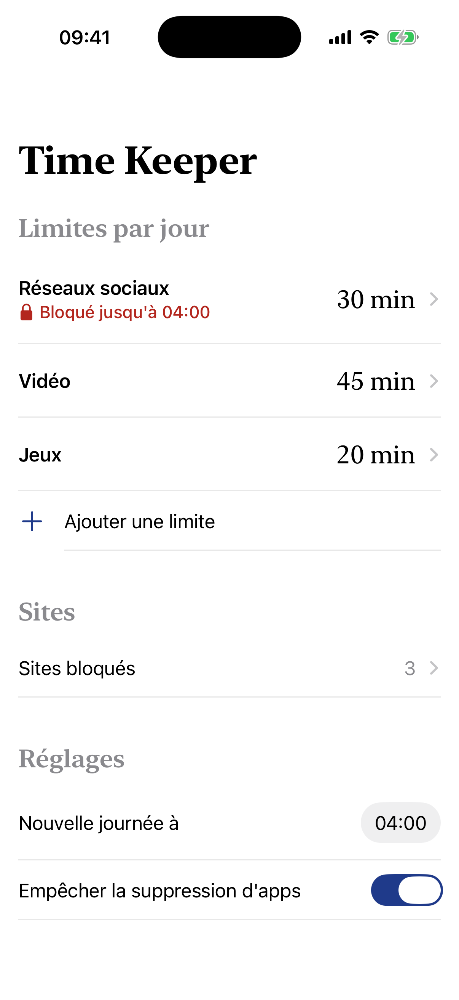
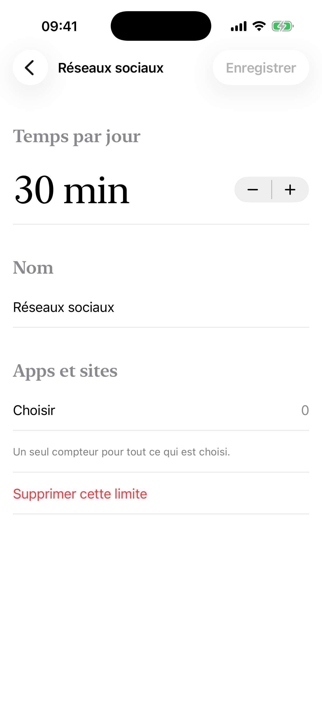
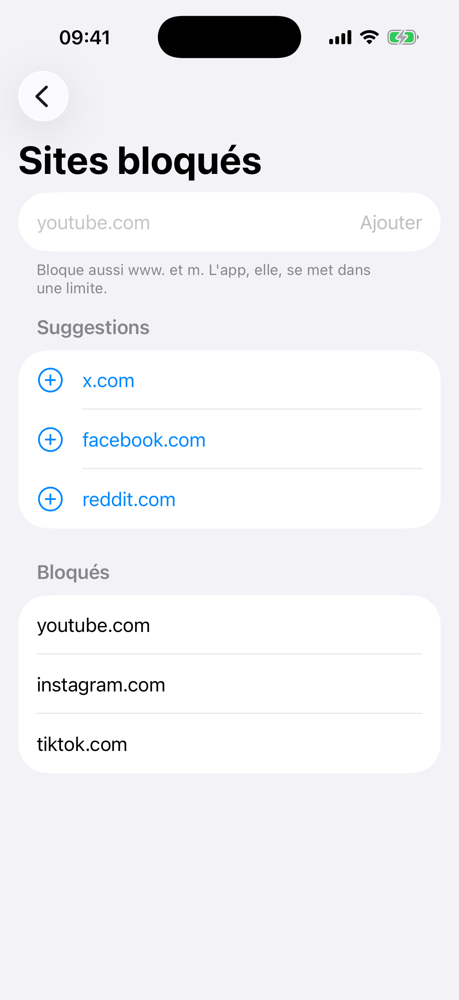
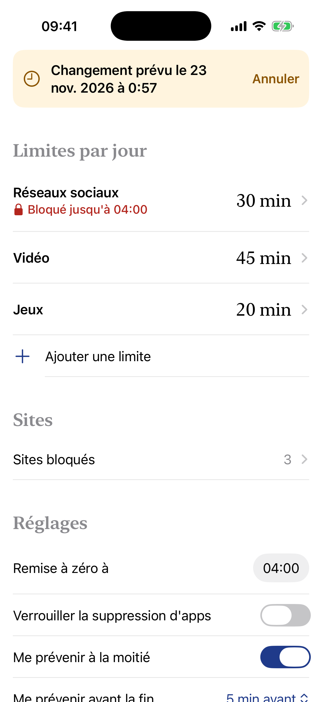
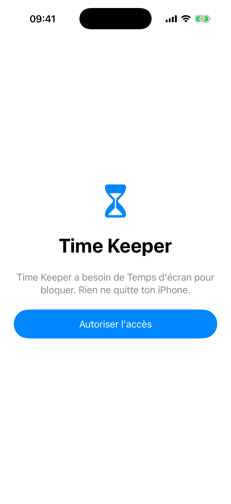

# Time Keeper

[](https://github.com/Seeyko/time-keeper/actions/workflows/ios.yml) [](LICENSE)

<p>





</p>

App iOS libre et gratuite (Swift / SwiftUI) pour :

1. **Limiter des apps par temps d'écran quotidien.** Exemple : Instagram + TikTok, 30 min par jour au total. Une fois le temps écoulé, elles sont bloquées jusqu'au début de la journée suivante. L'heure de début de journée se règle (minuit, 4 h, 6 h…).
2. **Bloquer des sites précis** (youtube.com, instagram.com…) **dans tous les navigateurs** (Safari, Chrome…) sans bloquer le navigateur lui-même.
3. **Rester strict.** L'écran de blocage n'a qu'un bouton « Fermer ». Il n'y a ni « Ignorer la limite », ni « Encore 15 minutes », ni code de déblocage.

Pas d'abonnement, pas de serveur, pas de compte : tout tourne sur l'iPhone.

## Comment c'est strict

| Action | Effet |
|---|---|
| Ajouter une limite, baisser un temps, ajouter une app, bloquer un site, activer le verrou | **Immédiat** |
| Monter un temps, retirer une app, supprimer une limite, débloquer un site, couper le verrou | **Seulement 24 h plus tard** |
| Modifier une limite en cours de journée | Le compteur ne repart **pas** de zéro (`includesPastActivity`) |
| App bloquée aujourd'hui | Reste bloquée jusqu'au début de la journée suivante, même si tu montes la limite |
| Changer l'heure de début de journée | **Seulement 24 h plus tard** |
| Supprimer l'app pour contourner | Impossible si « Empêcher la suppression d'apps » est activé |

Un assouplissement en attente peut toujours être annulé (c'est plus strict), jamais accéléré.

## Architecture

Le projet utilise les API Temps d'écran d'Apple (FamilyControls, ManagedSettings, DeviceActivity) :

```
ios/project.yml                 Définition du projet Xcode (XcodeGen)
ios/TimeKeeper/                 App SwiftUI : autorisation, limites, sites, réglages
ios/Shared/                     Règles, moteur et stockage App Group (app + monitor)
ios/TimeKeeperMonitor/          Extension DeviceActivityMonitor : bloque au seuil, débloque au début de la journée
ios/TimeKeeperShieldConfig/     Écran de blocage (un seul bouton « Fermer »)
ios/TimeKeeperShieldAction/     Tout bouton de l'écran de blocage -> fermer
ios/TimeKeeperTests/            Tests des règles anti-triche
```

- **Limites quotidiennes** : une `DeviceActivitySchedule` de 24 h qui commence à l'heure de début de journée choisie, répétée chaque jour, avec un `DeviceActivityEvent` au seuil choisi. L'extension Monitor applique un `ManagedSettingsStore` nommé par limite (`shield.applications`, `shield.applicationCategories`, `shield.webDomains`).
- **Sites toujours bloqués** : `webContent.blockedByFilter = .specific([...])`. C'est le filtre web système, appliqué à tous les navigateurs iOS. Le domaine est ajouté avec `www.` et `m.`.
- **Verrou** : `application.denyAppRemoval = true`.

## Installer sur ton iPhone

Il faut un Mac avec Xcode 16 ou plus, et un iPhone sous iOS 17.4 ou plus.

1. Installe XcodeGen : `brew install xcodegen`
2. `cd ios && xcodegen generate`, puis ouvre `ios/TimeKeeper.xcodeproj`.
3. Dans `ios/project.yml`, mets ton Team ID dans `DEVELOPMENT_TEAM`. Si `com.seeyko.timekeeper` est déjà pris, change `BUNDLE_ID_ROOT` et `APP_GROUP_ID`. Relance ensuite `xcodegen generate`.
4. Branche l'iPhone, choisis-le comme destination, puis lance (⌘R). Xcode crée les identifiants, l'App Group et la capability Family Controls en mode développement.
5. Sur l'iPhone, autorise le développeur dans Réglages > Général > VPN et gestion de l'appareil, puis active le mode développeur si iOS le demande.
6. Ouvre Time Keeper, touche « Autoriser l'accès » et valide avec Face ID.

> **Point important sur le compte Apple :** la capability Family Controls n'est en principe **pas disponible avec un compte Apple gratuit** (« Personal Team »). De plus, une app signée avec un compte gratuit expire au bout de 7 jours. Il faut donc l'**Apple Developer Program (99 €/an)**. Ce n'est pas un abonnement à une app, mais c'est un coût. Avec ce compte, l'app installée depuis Xcode reste valable environ un an. Pour TestFlight ou l'App Store, il faudrait en plus demander à Apple l'entitlement Family Controls de distribution (formulaire en ligne). Pour un usage perso via Xcode, ce n'est pas nécessaire.

## Ce qu'aucune app ne peut empêcher (limites d'iOS)

Sois honnête avec toi-même, voici les contournements possibles et les parades :

- **Retirer l'accès Temps d'écran** dans Réglages > Temps d'écran : iOS lève alors tous les blocages. Parade : active un **code Temps d'écran** et confie-le à quelqu'un d'autre (Réglages > Temps d'écran > Verrouiller les réglages). À tester sur ton iOS, le comportement varie selon les versions.
- **Changer la date ou le fuseau horaire** pour avancer le début de journée. Parade : la même, avec le code Temps d'écran pour verrouiller Date et heure en réglage automatique.
- **L'app YouTube ≠ youtube.com.** Bloquer le site ne bloque pas l'app, et inversement. Mets l'app dans une limite quotidienne, ou supprime-la.
- **Limites par site (dans une limite quotidienne)** : iOS ne compte le temps d'un site que dans Safari, et le sélecteur d'Apple ne propose que les sites déjà ouverts dans Safari. Un site manque ? Ouvre-le une fois dans Safari. Une fois le temps passé, le site est aussi bloqué dans tous les navigateurs jusqu'à la remise à zéro. Le temps passé sur ce site dans Chrome ne compte pas : iOS ne le donne pas.
- **Navigateurs à moteur non WebKit** (possibles dans l'UE) : Apple leur impose de respecter les restrictions Temps d'écran, mais c'est à vérifier navigateur par navigateur.
- **Limites techniques** : 50 domaines maximum dans le filtre web (soit environ 16 sites avec leurs variantes www./m.) et 50 apps maximum par limite.

## Ce qui reste à faire / idées

- Un écran « temps utilisé aujourd'hui » (extension `DeviceActivityReport`).
- Des plages horaires (par exemple tout bloquer de 23 h à 7 h).
- Un délai d'assouplissement réglable (24 h, 48 h, 7 jours).

## Déploiement

Chaque fusion sur `main` lance les tests puis envoie un build sur TestFlight (workflow `iOS`). Les PR ne lancent que les tests. Les secrets et leur emplacement sont décrits dans [`SECRETS.md`](SECRETS.md).

## Contribuer

Les PR sont bienvenues : lis [`CONTRIBUTING.md`](CONTRIBUTING.md). Une faille ou un contournement à signaler : [`SECURITY.md`](SECURITY.md).

## Licence

[MIT](LICENSE).
