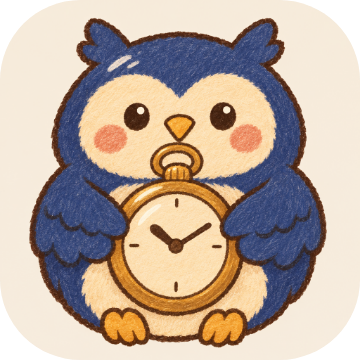
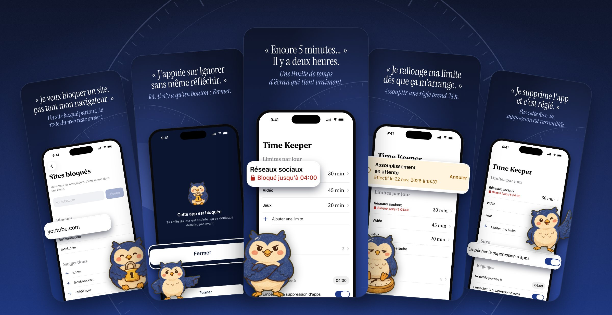
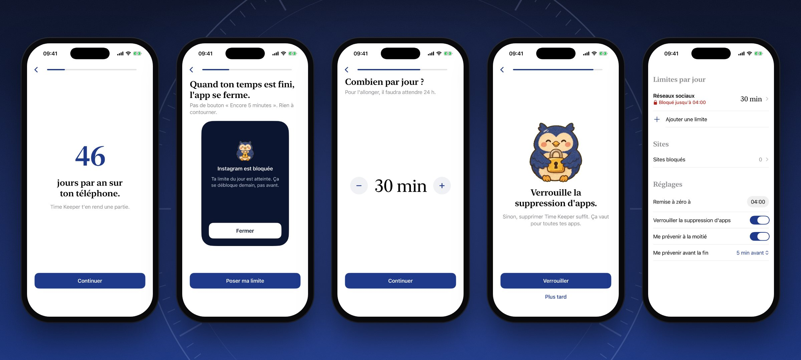
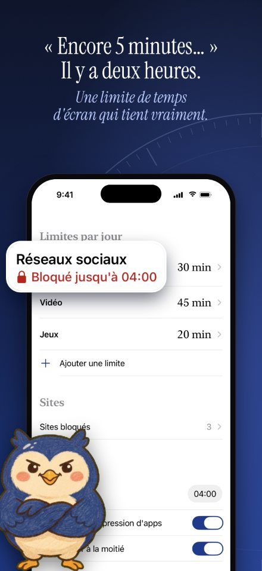
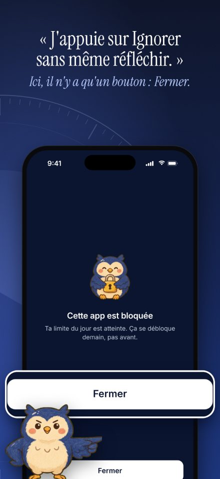
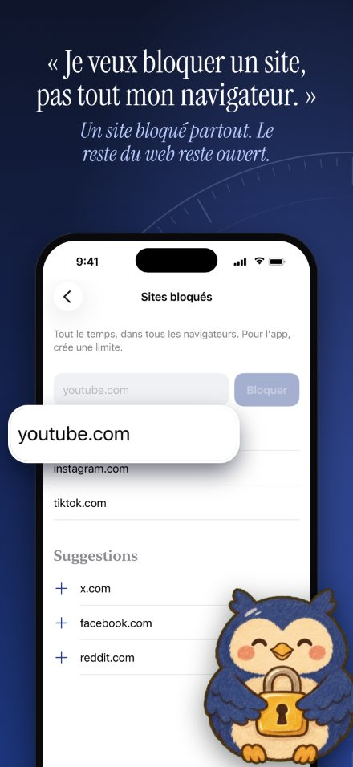
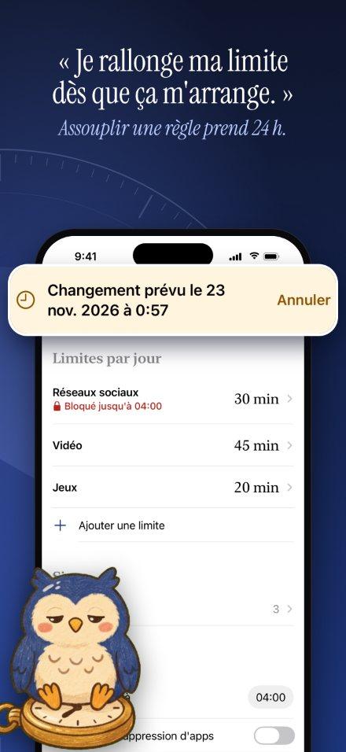
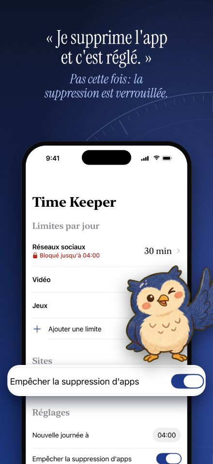
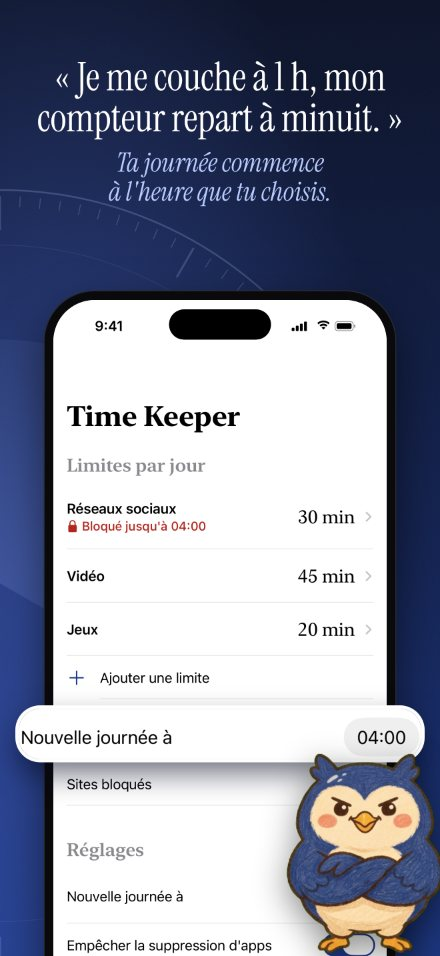
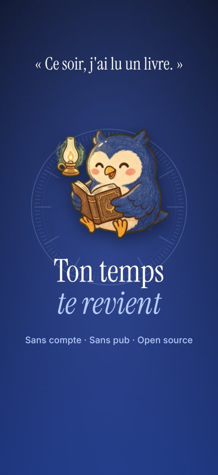

<div align="center">



<picture>
  <source media="(prefers-color-scheme: dark)" srcset=".github/readme/wordmark-dark.png">
  
</picture>

<p>
  Limite ton temps d'écran et bloque des sites, sans aucun moyen de tricher sur le moment.<br>
  Limite atteinte, l'app reste fermée jusqu'à demain.
</p>

<p>
  <a href="https://github.com/Seeyko/time-keeper/actions/workflows/ios.yml"></a>
  
  
  <a href="LICENSE"></a>
  
</p>

<p>
  <a href="#pourquoi">Pourquoi</a> ·
  <a href="#comment-cest-strict">Comment c'est strict</a> ·
  <a href="#le-parcours">Le parcours</a> ·
  <a href="#confidentialité">Confidentialité</a> ·
  <a href="#installer-sur-ton-iphone">Installer</a> ·
  <a href="#contribuer">Contribuer</a>
</p>

<br>



</div>

<br>

## Pourquoi

Tu connais le message « Limite atteinte ». Tu appuies sur « Ignorer », et tu continues. Ici, ce bouton n'existe pas.

| Ce que tu te dis | Ce que fait Time Keeper |
|---|---|
| « J'appuie sur Ignorer sans même réfléchir. » | L'écran de blocage n'a qu'un bouton : **Fermer**. |
| « Je veux bloquer youtube.com, pas tout Safari. » | Un site bloqué **dans tous les navigateurs**. Le reste du web reste ouvert. |
| « Je rallonge ma limite dès que ça m'arrange. » | Durcir, c'est tout de suite. **Assouplir, c'est dans 24 h.** |
| « Je supprime l'app et c'est réglé. » | La suppression d'apps peut être **verrouillée**. |
| « Je me couche à 1 h, mon compteur repart à minuit. » | Ta journée commence **à l'heure que tu choisis**. |

Et pour fermer l'app à temps : une notification à la moitié du temps, puis quand il reste 5 minutes. Ça se règle.

## Comment c'est strict

| Action | Effet |
|---|---|
| Ajouter une limite, baisser un temps, ajouter une app, bloquer un site, activer le verrou | **Immédiat** |
| Monter un temps, retirer une app, supprimer une limite, débloquer un site, couper le verrou | **Seulement 24 h plus tard** |
| Changer l'heure de début de journée | **Seulement 24 h plus tard** |
| Modifier une limite en cours de journée | Le compteur ne repart **pas** de zéro (`includesPastActivity`) |
| App bloquée aujourd'hui | Reste bloquée jusqu'au début de la journée suivante, même si tu montes la limite |
| Supprimer l'app pour contourner | Impossible si « Empêcher la suppression d'apps » est activé |

Un assouplissement en attente peut toujours être annulé (c'est plus strict), jamais accéléré. Le test `RulesTests` le prouve pour chaque cas.

## Le parcours

<div align="center">
  
  <p><sub>Tes jours par an sur le téléphone, l'écran de blocage, ta limite, le verrou, et c'est parti.</sub></p>
</div>

<details>
<summary><b>Les 7 captures de l'App Store</b></summary>
<br>
<p align="center">
  
  
  
  
</p>
<p align="center">
  
  
  
</p>
<p align="center"><sub>Générées par <code>store/make/render.cjs</code>, voir <a href="store/README.md"><code>store/README.md</code></a>.</sub></p>
</details>

## Prix

Sans compte et sans pub. Sur l'App Store : **7 jours d'essai**, puis **19,99 € par an** ou **39,99 € à vie**. Le code reste ouvert sous licence MIT : compilée toi-même depuis ce dépôt, elle reste gratuite (voir plus bas).

## Confidentialité

- **Tes apps, tes sites et ton temps restent sur ton iPhone.** Apple ne les montre à Time Keeper que sous forme de jetons anonymes, et rien de tout ça n'est envoyé.
- **Statistiques anonymes** pour améliorer l'app : les écrans de l'onboarding vus, le paywall, l'offre choisie, les achats et essais, et les avis que tu envoies toi-même. Hébergées dans l'UE par PostHog, adresse IP jetée, identifiant aléatoire, sans nom.
- **Un interrupteur** « Statistiques anonymes » dans les réglages coupe tout.

Le détail : [`PRIVACY.md`](PRIVACY.md).

## Installer sur ton iPhone

Il faut un Mac avec Xcode 16 ou plus, et un iPhone sous iOS 17.4 ou plus.

1. Installe XcodeGen : `brew install xcodegen`
2. `cd ios && xcodegen generate`, puis ouvre `ios/TimeKeeper.xcodeproj`.
3. Dans `ios/project.yml`, mets ton Team ID dans `DEVELOPMENT_TEAM`. Si `com.seeyko.timekeeper` est déjà pris, change `BUNDLE_ID_ROOT` et `APP_GROUP_ID`. Relance ensuite `xcodegen generate`.
4. Branche l'iPhone, choisis-le comme destination, puis lance (⌘R). Xcode crée les identifiants, l'App Group et la capability Family Controls en mode développement.
5. Sur l'iPhone, autorise le développeur dans Réglages > Général > VPN et gestion de l'appareil, puis active le mode développeur si iOS le demande.
6. Ouvre Time Keeper, touche « Autoriser l'accès » et valide avec Face ID.

> **Point important sur le compte Apple :** la capability Family Controls n'est en principe **pas disponible avec un compte Apple gratuit** (« Personal Team »). De plus, une app signée avec un compte gratuit expire au bout de 7 jours. Il faut donc l'**Apple Developer Program (99 €/an)**. Ce n'est pas un abonnement à une app, mais c'est un coût. Avec ce compte, l'app installée depuis Xcode reste valable environ un an. Pour TestFlight ou l'App Store, il faudrait en plus demander à Apple l'entitlement Family Controls de distribution (formulaire en ligne). Pour un usage perso via Xcode, ce n'est pas nécessaire.

<details>
<summary><b>Ce qu'aucune app ne peut empêcher (limites d'iOS)</b></summary>
<br>

Sois honnête avec toi-même, voici les contournements possibles et les parades :

- **Retirer l'accès Temps d'écran** dans Réglages > Temps d'écran : iOS lève alors tous les blocages. Parade : active un **code Temps d'écran** et confie-le à quelqu'un d'autre (Réglages > Temps d'écran > Verrouiller les réglages). À tester sur ton iOS, le comportement varie selon les versions.
- **Changer la date ou le fuseau horaire** pour avancer le début de journée. Parade : la même, avec le code Temps d'écran pour verrouiller Date et heure en réglage automatique.
- **L'app YouTube ≠ youtube.com.** Bloquer le site ne bloque pas l'app, et inversement. Mets l'app dans une limite quotidienne, ou supprime-la.
- **Limites par site (dans une limite quotidienne)** : iOS ne compte le temps d'un site que dans Safari, et le sélecteur d'Apple ne propose que les sites déjà ouverts dans Safari. Un site manque ? Ouvre-le une fois dans Safari. Une fois le temps passé, le site est aussi bloqué dans tous les navigateurs jusqu'à la remise à zéro. Le temps passé sur ce site dans Chrome ne compte pas : iOS ne le donne pas.
- **Navigateurs à moteur non WebKit** (possibles dans l'UE) : Apple leur impose de respecter les restrictions Temps d'écran, mais c'est à vérifier navigateur par navigateur.
- **Limites techniques** : 50 domaines maximum dans le filtre web (soit environ 16 sites avec leurs variantes www./m.) et 50 apps maximum par limite.

</details>

<details>
<summary><b>Architecture</b></summary>
<br>

Le projet utilise les API Temps d'écran d'Apple (FamilyControls, ManagedSettings, DeviceActivity) :

```
ios/project.yml                 Définition du projet Xcode (XcodeGen)
ios/TimeKeeper/                 App SwiftUI : autorisation, limites, sites, réglages
ios/Shared/                     Règles, moteur et stockage App Group (app + monitor)
ios/TimeKeeperMonitor/          Extension DeviceActivityMonitor : bloque au seuil, débloque au début de la journée
ios/TimeKeeperShieldConfig/     Écran de blocage (un seul bouton « Fermer »)
ios/TimeKeeperShieldAction/     Tout bouton de l'écran de blocage -> fermer
ios/TimeKeeperTests/            Tests des règles anti-triche
```

- **Limites quotidiennes** : une `DeviceActivitySchedule` de 24 h qui commence à l'heure de début de journée choisie, répétée chaque jour, avec un `DeviceActivityEvent` au seuil choisi. L'extension Monitor applique un `ManagedSettingsStore` nommé par limite (`shield.applications`, `shield.applicationCategories`, `shield.webDomains`).
- **Sites toujours bloqués** : `webContent.blockedByFilter = .specific([...])`. C'est le filtre web système, appliqué à tous les navigateurs iOS. Le domaine est ajouté avec `www.` et `m.`.
- **Verrou** : `application.denyAppRemoval = true`.

</details>

## Idées

- Un écran « temps utilisé aujourd'hui » (extension `DeviceActivityReport`).
- Des plages horaires (par exemple tout bloquer de 23 h à 7 h).
- Un délai d'assouplissement réglable (24 h, 48 h, 7 jours).

## Déploiement

Chaque fusion sur `main` lance les tests puis envoie un build sur TestFlight (workflow `iOS`). Les PR ne lancent que les tests. Les secrets et leur emplacement sont décrits dans [`SECRETS.md`](SECRETS.md).

## Contribuer

Les PR sont bienvenues : lis [`CONTRIBUTING.md`](CONTRIBUTING.md). Une faille ou un contournement à signaler : [`SECURITY.md`](SECURITY.md).

<br>

<div align="center">
  
  <p><i>Ton temps te revient.</i></p>
  <sub><a href="LICENSE">MIT</a> · fait avec soin, sans bouton « Ignorer »</sub>
</div>
